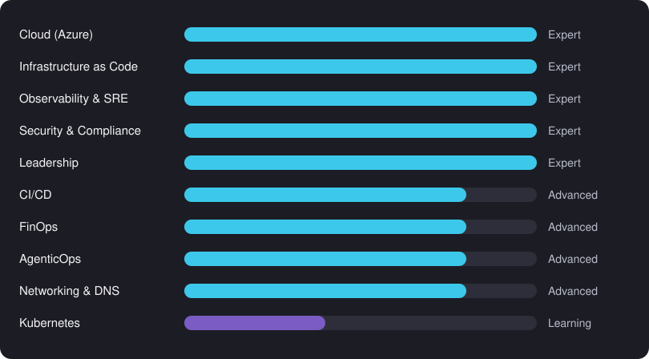

<!-- Generated from profile.yaml by scripts/build.py. Edit profile.yaml, not this file. -->

# Diego Albarado

**DevOps & Platform Engineering Lead · Azure · IaC · AgenticOps**

Buenos Aires, Argentina · Spanish, English · [LinkedIn](https://www.linkedin.com/in/diego-albarado/) · [GitHub](https://github.com/dalbarado)

18 years building and running platforms and the teams behind them, across platform engineering, cloud architecture and security. Today I run a HIPAA and SOC 2 Azure platform for a global pharma company end to end, with AI-assisted triage in production. Before that I scaled a DevOps practice from 15 to 80+ engineers through the pandemic.

| **15 → 80+** | **2022** | **~3 years** | **Minutes** |
|---|---|---|---|
| DevOps engineers scaled at Globant, on an 800+ person account | DASA DevOps Award, Business Value, while I led the account's DevOps portfolio | under budget on a regulated Azure platform, with cost checked on every change | to detect production issues, with near-zero incidents |

## Skills

| Area | Level | Tools and practices | Evidence |
| --- | --- | --- | --- |
| **Cloud (Azure)** | Expert | Front Door & WAF, API Management, Container Instances, Functions, Logic Apps, Cosmos DB, Azure SQL, Entra External ID, Key Vault, Azure DNS, Well-Architected Framework | Designed and run a patient-facing Azure platform end to end, encrypted throughout. |
| **Infrastructure as Code** | Expert | Terraform, Terragrunt, import-first codification, drift remediation | Codified live resources into Terraform to clean "no changes" plans; caught an apply that would have silently overwritten live API policies. |
| **Observability & SRE** | Expert | Azure Monitor, Log Analytics & KQL, Application Insights, Datadog, dynamic thresholds, alert tuning | Production monitoring with Slack alerting and dynamic thresholds that removed false-positive pages. |
| **Security & Compliance** | Expert | HIPAA, SOC 2, pentest remediation, WAF & rate limiting, least-privilege RBAC, ISO 27001 ISMS | Closed a failed pentest finding with per-client rate limiting and WAF tuning; built two cybersecurity offices from scratch. |
| **Leadership** | Expert | practice building, hiring bar, coaching & certifications, client-facing delivery | Scaled a fully remote DevOps practice as a system, with pods, onboarding and a hiring bar. |
| **CI/CD** | Advanced | Azure DevOps pipelines, plan/apply gates, GitHub Actions, pipeline notifications | Every infrastructure change goes through reviewed plan and apply pipelines. |
| **FinOps** | Advanced | Infracost in CI/CD, tagging, per-environment cost reviews | Cost is visible on every change before it ships; under budget for almost three years. |
| **AgenticOps** | Advanced | Claude Code, MCP servers (Azure, Datadog), read-only AI triage, agent guardrails, skills | AI-assisted triage live in production; AI reads and explains, people approve every change. |
| **Networking & DNS** | Advanced | DNS migrations, registrar transfers, SPF/DKIM/DMARC, VPN (SSTP, OpenVPN) | Planned and verified a multi-domain registrar migration with a DNS baseline and runbook. |
| **Kubernetes** | Learning | Kubernetes fundamentals | CKA is a planned certification. |

## Experience

| Period | Company | Role | |
| --- | --- | --- | --- |
| 2026 – today | Trifork | DevOps Subject Matter Expert | DevOps and AgenticOps practice proposals and pilots. |
| 2022 – today | Erlang Solutions (Trifork Group) | DevOps Lead | DevOps lead, with Lextech, on a global pharma company's US vaccine platform on Azure (HIPAA, SOC 2). |
| 2025 – 2026 | HiBeam | DevOps Tech Lead | [Add one line] |
| 2020 – 2023 | Globant | Tech Manager | Led the DevOps portfolio on the EY account (15 → 80+ engineers); also Apple BeHealthy and SmileDirectClub. |
| 2019 – 2020 | Droguería del Sud · DTC Security | Architecture and cybersecurity | Designed the architecture of Argentina's largest pharma distributor. |
| Before 2019 | Thomson Reuters · Deloitte | Architecture and security | Security and architecture roles. |

## Certifications

- 🗓️ AZ-305 Azure Solutions Architect Expert · planned
- 🗓️ Certified Kubernetes Administrator (CKA) · planned

---

_This profile is maintained as code: edit `profile.yaml`, open a PR, and CI validates it and regenerates this page._
